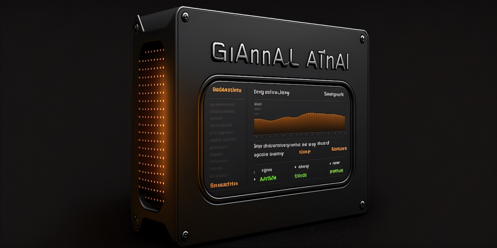

# Grafana Backup Action

<p align="center">
  
</p>

[](https://github.com/zentered/grafana-backup-action/actions/workflows/publish.yml)

This is a simple GitHub Action to backup Grafana Cloud dashboards.

## Usage

| Input             | Required | Description                                                                                   |
| ----------------- | -------- | --------------------------------------------------------------------------------------------- |
| `grafana_token`   | yes      | Grafana service account token (see below)                                                     |
| `grafana_org`     | no       | Grafana Cloud stack name. Builds the default URL `https://<grafana_org>.grafana.net`          |
| `grafana_url`     | no       | Grafana base URL. Use it for self-hosted Grafana. Set this or `grafana_org`                   |
| `output_folder`   | no       | Folder to save the backup to. Default: `backup`                                               |
| `overwrite_files` | no       | `true` overwrites files in `output_folder`. `false` writes a date-stamped sub-folder          |

Output: `backup_path` is the absolute path of the folder the files were
written to.

The environment variables from earlier versions still work as a fallback. An
input wins over its variable:

| Input             | Fallback variable       |
| ----------------- | ----------------------- |
| `grafana_token`   | `GRAFANA_CLOUD_API_KEY` |
| `grafana_org`     | `GRAFANA_ORG`           |
| `grafana_url`     | `GRAFANA_URL`           |
| `output_folder`   | `OUTPUT_FOLDER`         |
| `overwrite_files` | `OVERWRITE_FILES`       |

### Token

Use a [service account token](https://grafana.com/docs/grafana/latest/administration/service-accounts/)
with the `Viewer` role. Grafana deprecated API keys in favor of service accounts. The action only
reads dashboards and folders. Store the token as a repository secret. The
action masks it in logs.

### GitHub Actions

Create a new repository and add the following workflow file to
`.github/workflows/grafana-backup.yml`:

```
name: Grafana Backup

on:
  workflow_dispatch:
  schedule:
    - cron: '0 2 * * *'

jobs:
  grafana-backup:
    runs-on: ubuntu-latest
    steps:
      - uses: actions/checkout@v7
      - name: Grafana Backup
        uses: zentered/grafana-backup-action@v1.2.0
        with:
          grafana_token: ${{ secrets.GRAFANA_TOKEN }}
          grafana_org: '<your-org>'
          output_folder: backup
          overwrite_files: true
      - uses: EndBug/add-and-commit@v9
        with:
          default_author: github_actions
```

### Local

Add your token and the organization name to `.env` (see `.env.example`).

Run `npm run dev` to backup all dashboards to `backup`.

## License

Licensed under [MIT](./LICENSE).
